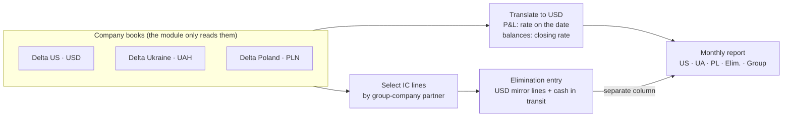

# Implementation plan: Delta Group consolidation module (Odoo)

Planned on 19 Nov 2026, before implementation.

## 1. What the task asks for

An Odoo module that removes intercompany transactions and balances from the group's USD reporting and leaves the three companies' books untouched. Reviewers assess understanding of the problem, written assumptions, the AI workflow and proof of the numbers, not the volume of code.

| Requirement | What it means for the solution |
| --- | --- |
| Eliminations are the core of the task | Most of the time goes to the elimination engine and tests on the numbers |
| The standard P&L always shows a company's real books | Eliminations are never written to the companies' `account.move` |
| The auditor wants an elimination entry they can open | A separate record with lines and a link to each source journal item |
| The group reports in USD; books are kept in USD / UAH / PLN | A currency translation layer with explicit rules |
| Demo data loads with one command | A Python loader and one `docker compose` command |
| Tests prove the numbers, not the screens | Expected figures are computed up front, independently of the module |
| 2–3 hours; not everything will fit | Strict priorities and an assumptions list in the README |

Traps built into the demo data:

1. **Cut-off.** Ukraine's USD 50,000 invoice is dated 31 Mar; Delta US booked it on 2 Apr.
2. **Credit note.** A partial credit note on one Poland → US invoice.
3. **Cash in transit.** Delta US pays Poland on 31 Mar; Poland records it on 1 Apr.
4. **Loan.** USD 200,000 from US to Ukraine since 15 Jan — a balance, not a flow.
5. **Three currencies.** USD intercompany documents sit in UAH and PLN books.

## 2. Assumptions

These assumptions close what the task leaves open; copy them into the README almost verbatim — they are part of what is assessed.

| # | Assumption | Why, and what stays out of scope |
| --- | --- | --- |
| 1 | Odoo 18.0 Community in Docker; the module depends on `account` only | The visible part of the task names no version. Behaviour was checked against the 18.0 and 19.0 sources; moving to 19.0 or 20.0 means changing the image tag and running the tests. The module installs the same way on Enterprise |
| 2 | The three companies are separate root companies, not branches | A branch (`parent_id`) always inherits its parent's currency |
| 3 | One chart of accounts, `generic_coa`, for all three; no country is set on the companies | Local charts (`l10n_ua`, `l10n_pl`) and an account mapping table are out of scope |
| 4 | Intercompany documents are always in USD | The task says so. A line in another currency goes to the exception list instead of being silently lost |
| 5 | Intercompany invoices carry no taxes | VAT on cross-border services is out of scope |
| 6 | An intercompany line = a journal item whose partner is another group company, on a receivable/payable, income or expense account, or on an account flagged Intercompany | Detection by partner, not by account number |
| 7 | Translation to USD: P&L at the rate on the line date; assets and liabilities at the month-end rate; equity at the historical rate; the difference goes to a separate CTA line in equity | The standard current-rate method. No monthly average rate |
| 8 | Subsidiaries do not revalue foreign-currency balances; intercompany USD balances are taken at nominal | A simplification versus IAS 21: under the standard, the FX difference on the loan and intercompany balances would hit the subsidiary's and the group's P\&L; here it goes to CTA |
| 9 | Exchange differences are not eliminated | They are a real result of the group |
| 10 | Eliminated: transactions and balances — invoices, credit notes, payments, the loan | Investment in subsidiaries' equity, minority interest and unrealised profit are out of scope |
| 11 | One calendar fiscal year, no opening balances | Carrying elimination effects across the year end is out of scope |
| 12 | No interest is accrued on the loan | If accrued, it falls under the general income/expense elimination rule |
| 13 | Eliminations are created with a button at month close; a draft is regenerated, a posted entry is locked | Auto-creation on every posting gives no verifiable result as of a date |
| 14 | Delta Ukraine has a small external sale in the demo | Its description says it works only for Delta US, but the demo requires external sales for all three companies |
| 15 | Rates: one shared table without a company, USD base; the values are illustrative | 40 / 41 / 42 / 43 UAH and 4.0 / 4.1 / 4.2 / 4.3 PLN per USD from the 1st of January–April 2026 |

## 3. Architecture

Eliminations live in the module's own models and never reach `account.move`. The group report is built from the translated journal items of the three companies plus the elimination lines.



The companies' standard reports read only the company books, so eliminations never appear in them.

Where to store eliminations — options considered:

| Option | Decision | Reason |
| --- | --- | --- |
| Journal entries in a dedicated Delta US journal | No | They change the company's standard P&L |
| Journal entries in a separate "elimination company" | No | A fourth company with its own chart of accounts: too much setup for 2–3 hours |
| The module's own models | Yes | Books untouched by design, the entry can be opened, every line links to its source |

Models of the `delta_consolidation` module:

| Model | Purpose | Key fields |
| --- | --- | --- |
| `delta.consol.group` | Group members and reporting currency | `company_ids`, `currency_id` |
| `delta.consol.elimination` | Elimination entry for a month — the auditor's document | `name` (ELIM/2026/03), `date_from`, `date_to`, `state` (draft / posted), `line_ids`, totals, exception list |
| `delta.consol.elimination.line` | Elimination line | `kind` (mirror / transit), `source_line_id` → `account.move.line`, `company_id`, `counterparty_company_id`, `account_id`, `date`, `balance` in USD |
| `delta.consol.report.line` | Report line for the chosen month, regenerated | `statement` (pl / bs), `section`, `account_label`, `entity`, `is_intercompany`, `amount_local`, `amount_usd`, `balance_usd` |
| `delta.consol.report.wizard` | Picks a month, computes, opens the pivot | `group_id`, `month` |
| `delta.consol.demo` | Demo data loader (AbstractModel, no table), shared by the command and the tests | `load()` method, reads `data/demo_dataset.json` |
| `account.account` (extension) | Flags loan accounts | `is_intercompany` |

The engine is three functions without UI; the tests call them directly:

1. `_ic_lines(group, date_from, date_to)` — selects intercompany lines.
2. `_translate(line, closing_date)` — translates a line to USD.
3. `_report_rows(group, month)` — report rows: the three companies' books plus eliminations as a fourth column.

Entry lifecycle: Generate rebuilds the draft lines for the month, Post locks the entry. Before computing, the report generates any missing months since the start of the year and leaves posted entries alone.

Access rights: `account.group_account_user` — full access; `account.group_account_readonly` — read access to entries and report lines and full access to the wizard (the auditor role). The wizard rebuilds report lines via `sudo()`, otherwise a read-only auditor could not build the report.

## 4. Elimination and translation rules

One rule: every intercompany journal item gets a mirror line in USD at nominal, and whatever a document leaves unbalanced goes to a "cash in transit" line. The two sides are never matched against each other — each is removed in full on its own date, so date mismatches do not break the result.

### Which line counts as intercompany (IC)

- The entry is posted: `parent_state = 'posted'`.
- `partner_id` is the partner of another group company (`res.company.partner_id`).
- Balance-sheet line: account type `asset_receivable` / `liability_payable`, or an account with `is_intercompany = True`.
- P&L line: account type `income*` / `expense*`, except the exchange-difference journal (`company.currency_exchange_journal_id`).
- A line with `amount_currency = 0` is skipped: these are exchange-difference lines on receivable and payable accounts, and they do not change the USD nominal.
- Line currency other than USD → the line is not mirrored and goes to the entry's exception list.

### How the monthly entry is built

1. Take the IC lines dated within the month.
2. For each, a mirror line: same account, company and date, `balance = −amount_currency`, link in `source_line_id`.
3. For each source document (`move_id`), compute `S` = the sum of `amount_currency` over its IC lines.
4. If `S ≠ 0`, add a `kind = transit` line for `+S` (asset "Intercompany cash in transit").
5. Check: the entry's `balance` sums to 0.

On an invoice or a credit note both lines are intercompany (revenue and receivable/payable), so `S = 0`. On a payment or the loan the other line is the bank, so `S ≠ 0`.

### What the rule does with the traps in the task

| Situation | Elimination lines | Group result |
| --- | --- | --- |
| Ukraine invoice 50,000 dated 31 Mar, booked by US on 2 Apr | March: Dr revenue 50,000 / Cr receivable 50,000. April: Cr expense 50,000 / Dr payable 50,000 | March profit is 50,000 below the sum of the companies, April 50,000 above; cumulative 0 |
| Poland → US credit note of 2,000 | Mirrored like an invoice, with the opposite sign on both sides | Poland → US elimination for March: 15,000 − 2,000 = 13,000 |
| US → Poland payment of 10,000: 31 Mar at US, 1 Apr at Poland | 31 Mar: Cr payable 10,000 / Dr cash in transit 10,000. 1 Apr: Dr receivable 10,000 / Cr cash in transit 10,000 | At 31 Mar the balance sheet shows a 10,000 in-transit asset; at 30 Apr — 0 |
| Loan of 200,000 on 15 Jan | Both sides on the same day: transit +200,000 and −200,000 | Loan receivable and payable = 0, transit = 0 |
| USD intercompany documents in UAH and PLN books | Both sides taken at USD nominal | IC accounts are exactly 0 in the group; the translation difference goes to CTA |

### Translating a line to USD (first matching rule)

1. The company keeps its books in USD → `balance` as is.
2. IC line in USD → `amount_currency`.
3. P&L line → `balance` at the rate on the line date.
4. Equity (`equity*`) → `balance` at the rate on the line date.
5. Other assets and liabilities → `balance` at the reporting month-end rate.

Two computed balance-sheet lines:

- "Current year earnings" = cumulative P&L under rules 1–3; the same for the eliminations column.
- A company's CTA = minus the sum of all its translated lines at the report date. The group balance sheet balances by construction.

Rates come from the standard API: `company_currency._convert(amount, usd, company, date, round=False)`. Round only on output.

### Counterparty reconciliation in the elimination entry

This block shows the auditor where the two sides differ and why. At 31 Mar 2026, cumulative, USD:

| Pair | Seller receivable | US payable | Difference | Seller revenue | US expense | Difference | Reason |
| --- | --- | --- | --- | --- | --- | --- | --- |
| Ukraine → US | 135,000 | 85,000 | 50,000 | 135,000 | 85,000 | 50,000 | March invoice not yet booked by US |
| Poland → US | 35,000 | 25,000 | 10,000 | 35,000 | 35,000 | 0 | Payment in transit |

## 5. Demo data and expected figures

A minimal set that still covers every point of the task; amounts are chosen so that USD figures come out round. All dates are in 2026. The expected figures below come from a separate plain-Python script, without Odoo.

### Seeds and the expected-figures file

All demo data lives in one file read by both the loader and the oracle; the tables below are a human-readable view of the same file. The ready-made files are attached to the plan — put them in the repository as they are.

| File | Contents | Written by | Read by |
| --- | --- | --- | --- |
| `delta_consolidation/data/demo_dataset.json` | Group, 3 companies, rates, 12 accounts, 6 external partners, the auditor user, 47 documents, which elimination months to post | A human | Loader, oracle |
| `docs/oracle.py` | Independent calculation under the rules of section 4, plus seed checks | A human | — |
| `delta_consolidation/tests/expected_figures.json` | Monthly profit in USD and local currency, balance sheets at each month end, elimination entries, cash in transit, counterparty reconciliation | `python docs/oracle.py` | Tests, README |

Document format in the seeds:

- `type: entry` — lines with `balance` in company currency (positive = debit); a line in another currency also has `currency` and `amount_currency`; `partner` is a group company key on an IC line.
- Invoice or credit note (`out_invoice`, `in_invoice`, `out_refund`, `in_refund`) — `partner`, `currency`, `invoice_date`, optional `date` (accounting date), lines with `account`, `name`, `amount` in document currency; `reverses` — the invoice a credit note reverses.
- Accounts in documents are keys of `accounts`: `xmlid` from generic\_coa, `bank` — the bank journal's account, `create` — a new loan account with code 1920 or 2920.

The oracle checks the seeds itself: every document balances, foreign-currency amounts match the rate on the date, each company's balance sheet balances, IC lines are zero at group level. `expected_figures.json` stores the seeds' sha256, so a stale expected file is caught by `python docs/oracle.py --check` and by test 1. The passwords admin / admin and auditor / auditor are for local runs only.

### Rates per 1 USD

| Valid from | UAH | PLN |
| --- | --- | --- |
| 1 Jan | 40.0 | 4.0 |
| 1 Feb | 41.0 | 4.1 |
| 1 Mar | 42.0 | 4.2 |
| 1 Apr | 43.0 | 4.3 |

### Delta US Inc., USD

| Date | Document | Amount, USD |
| --- | --- | --- |
| 2 Jan | Share capital paid into the bank | 500,000 |
| 15 Jan | Loan to Delta Ukraine (account flagged Intercompany) | 200,000 |
| 31 Jan / 28 Feb / 31 Mar | Invoices to an external customer | 150,000 / 160,000 / 170,000 |
| 31 Jan / 28 Feb / 31 Mar | Payroll paid from the bank | 60,000 each month |
| 31 Jan / 28 Feb / 31 Mar | External vendor bills, unpaid | 5,000 each month |
| 31 Jan / 28 Feb / 2 Apr | Bills from Delta Ukraine; the third has `invoice_date` 31 Mar and `date` 2 Apr | 40,000 / 45,000 / 50,000 |
| 31 Jan / 28 Feb / 31 Mar | Bills from Delta Poland | 10,000 / 12,000 / 15,000 |
| 10 Mar | Credit note from Delta Poland on the February bill | −2,000 |
| 31 Mar | Payment to Delta Poland for the January bill | 10,000 |

### Delta Ukraine LLC, UAH

| Date | Document | Amount, UAH |
| --- | --- | --- |
| 15 Jan | Loan of USD 200,000 received (account flagged Intercompany) | 8,000,000 |
| 31 Jan / 28 Feb / 31 Mar | Invoices to Delta US for USD 40,000 / 45,000 / 50,000 | 1,600,000 / 1,845,000 / 2,100,000 |
| 31 Jan / 28 Feb / 31 Mar | Invoices to an external customer | 400,000 / 410,000 / 420,000 |
| 31 Jan / 28 Feb / 31 Mar | Payroll paid from the bank | 1,200,000 / 1,230,000 / 1,260,000 |
| 31 Jan / 28 Feb / 31 Mar | Rent bills, unpaid | 80,000 / 82,000 / 84,000 |

### Delta Poland sp. z o.o., PLN

| Date | Document | Amount, PLN |
| --- | --- | --- |
| 2 Jan | Loan from an external bank | 200,000 |
| 31 Jan / 28 Feb / 31 Mar | Invoices to Delta US for USD 10,000 / 12,000 / 15,000 | 40,000 / 49,200 / 63,000 |
| 10 Mar | Credit note to Delta US for USD 2,000 | −8,400 |
| 31 Jan / 28 Feb / 31 Mar | Invoices to external customers | 80,000 / 82,000 / 84,000 |
| 31 Jan / 28 Feb / 31 Mar | Payroll paid from the bank | 60,000 / 61,500 / 63,000 |
| 31 Jan / 28 Feb / 31 Mar | Rent bills, unpaid | 8,000 / 8,200 / 8,400 |
| 1 Apr | Receipt from Delta US, USD 10,000 | 43,000 |

Invoices and payments in the demo are not reconciled with each other: otherwise Odoo would create exchange-difference entries in the Ukraine and Poland books and shift the expected figures. The engine does not depend on reconciliation.

### Expected figures: profit and loss by month

| Line | January | February | March |
| --- | --- | --- | --- |
| Group external revenue, USD | 180,000 | 190,000 | 200,000 |
| IC revenue Ukraine + Poland, USD | 50,000 | 57,000 | 63,000 |
| IC expense in the US books, USD | 50,000 | 57,000 | 13,000 |
| US profit, USD | 35,000 | 38,000 | 92,000 |
| Ukraine profit, UAH | 720,000 | 943,000 | 1,176,000 |
| Ukraine profit, USD | 18,000 | 23,000 | 28,000 |
| Poland profit, PLN | 52,000 | 61,500 | 67,200 |
| Poland profit, USD | 13,000 | 15,000 | 16,000 |
| Effect of eliminations on profit, USD | 0 | 0 | −50,000 |
| **Group profit, USD** | **66,000** | **76,000** | **86,000** |

Group profit year to date at 31 Mar — USD 228,000.

### Expected figures: balance sheet at 31 Mar 2026, USD

| Line | US | Ukraine | Poland | Eliminations | Group |
| --- | --- | --- | --- | --- | --- |
| Bank | 110,000.00 | 102,619.05 | 3,690.48 |  | 216,309.52 |
| Cash in transit |  |  |  | 10,000.00 | 10,000.00 |
| External receivables | 480,000.00 | 29,285.71 | 58,571.43 |  | 567,857.14 |
| IC receivables |  | 135,000.00 | 35,000.00 | −170,000.00 | 0.00 |
| IC loan receivable | 200,000.00 |  |  | −200,000.00 | 0.00 |
| **Assets** | **790,000.00** | **266,904.76** | **97,261.90** | **−360,000.00** | **794,166.67** |
| External payables | 15,000.00 | 5,857.14 | 5,857.14 |  | 26,714.29 |
| Bank loan |  |  | 47,619.05 |  | 47,619.05 |
| IC payables | 110,000.00 |  |  | −110,000.00 | 0.00 |
| IC loan payable |  | 200,000.00 |  | −200,000.00 | 0.00 |
| Share capital | 500,000.00 |  |  |  | 500,000.00 |
| Current year earnings | 165,000.00 | 69,000.00 | 44,000.00 | −50,000.00 | 228,000.00 |
| CTA |  | −7,952.38 | −214.29 |  | −8,166.67 |
| **Liabilities and equity** | **790,000.00** | **266,904.76** | **97,261.90** | **−360,000.00** | **794,166.67** |

Totals are computed from exact values, so the sum of rounded rows may differ from the total by 0.01 (Poland assets, group assets). Tests compare with a 0.01 tolerance.

Local-currency balances at 31 Mar, for checking the loader:

| Line | Ukraine, UAH | Poland, PLN |
| --- | --- | --- |
| Bank | 4,310,000 | 15,500 |
| External receivables | 1,230,000 | 246,000 |
| IC receivables | 5,545,000 | 143,800 |
| External payables | 246,000 | 24,600 |
| IC loan received / bank loan | 8,000,000 | 200,000 |
| Current year earnings | 2,839,000 | 180,700 |

### Expected figures: elimination entries

| Entry | Lines | Debit = credit, USD | Effect on profit, USD |
| --- | --- | --- | --- |
| ELIM/2026/01 | 12 | 500,000 | 0 |
| ELIM/2026/02 | 8 | 114,000 | 0 |
| ELIM/2026/03 | 12 | 94,000 | −50,000 |
| ELIM/2026/04 | 4 | 60,000 | +50,000 |

At 30 Apr: cash in transit = 0, the cumulative effect of eliminations on profit = 0, group profit year to date is still 228,000.

## 6. Implementation steps

Seven steps, 175 minutes with a buffer; each step ends with a check, and the next step does not start until it passes.

| # | Step | Min | Done when |
| --- | --- | --- | --- |
| 0 | Environment and an empty module | 10 | `docker compose run --rm test` exits with code 0, the module is installed |
| 1 | SPEC, assumptions, seeds and expected figures in the repository | 10 | `python docs/oracle.py --check` exits with code 0, the figures match section 5 |
| 2 | Demo data loader | 35 | The company books test is green: profit and balances in local currency match the expected figures |
| 3 | Elimination engine | 40 | Entry tests are green: balanced, line count, amounts, books unchanged |
| 4 | Translation and report | 35 | Group P&L and balance sheet tests are green |
| 5 | Auditor screen and access rights | 10 | The entry opens, the link to the source journal item works |
| 6 | README and a clean run | 20 | The section 8 checklist passes on a fresh clone |
|  | Buffer | 15 |  |

### Step 0. Environment

- Layout: `delta_consolidation/` (`models/`, `wizard/`, `views/`, `security/`, `data/`, `tests/`, `scripts/`), `docker-compose.yml`, `odoo.conf`, `README.md`, `ASSUMPTIONS.md`, `CLAUDE.md`, `docs/`.
- `__manifest__.py`: `depends: ['account']`, license, the `data` list.
- The three commands that go into the README:

```bash
docker compose run --rm demo    # database + module + demo data
docker compose run --rm test    # automated tests, exit code 0 = all green
docker compose up -d odoo       # UI: http://localhost:8069, database delta, admin / admin
```

- `docker-compose.yml` follows the official image's entrypoint but has not been run here; the step 0 check covers that:

```yaml
services:
  db:
    image: postgres:16
    environment:
      POSTGRES_USER: odoo
      POSTGRES_PASSWORD: odoo
      POSTGRES_DB: postgres
    volumes:
      - db-data:/var/lib/postgresql/data
    healthcheck:
      test: ["CMD-SHELL", "pg_isready -U odoo"]
      interval: 2s
      retries: 30

  odoo: &odoo
    image: odoo:18.0
    depends_on:
      db:
        condition: service_healthy
    ports: ["8069:8069"]
    volumes:
      - ./delta_consolidation:/mnt/extra-addons/delta_consolidation
      - ./odoo.conf:/etc/odoo/odoo.conf:ro
      - odoo-data:/var/lib/odoo
    command: ["odoo", "-d", "delta"]

  demo:
    <<: *odoo
    profiles: ["tools"]
    entrypoint: ["bash", "-c"]
    command:
      - >-
        odoo -d delta -i delta_consolidation
        --without-demo=all --stop-after-init
        && odoo shell -d delta --no-http
        < /mnt/extra-addons/delta_consolidation/scripts/load_demo.py

  test:
    <<: *odoo
    profiles: ["tools"]
    command: ["odoo", "-d", "delta_test", "-i", "delta_consolidation",
              "--without-demo=all", "--test-tags", "/delta_consolidation", "--stop-after-init"]

volumes:
  db-data:
  odoo-data:
```

```ini
; odoo.conf
[options]
addons_path = /mnt/extra-addons
data_dir = /var/lib/odoo
db_host = db
db_port = 5432
db_user = odoo
db_password = odoo
```

- `db-data` and `odoo-data` are named volumes: `run --rm` removes anonymous volumes, so after `demo` the UI would be left without the filestore (attachments and logos). Reset with `docker compose down -v`.
- No `-u` is needed: in 18.0 `-i` also marks an already installed module for reloading, and its tests run again on a repeated run.
- `scripts/load_demo.py` — two lines: `env['delta.consol.demo'].load()` and `env.cr.commit()`. Without the commit the data is lost: `odoo shell` rolls back the transaction at the end.
- Timing (estimate): the first run takes 5–10 minutes because of image downloads, then 2–3 minutes to create a database with `account`.

### Step 1. Specification and expected figures

- `docs/SPEC.md` — the rules of section 4 and the models of section 3.
- `ASSUMPTIONS.md` — the table from section 2.
- `delta_consolidation/data/demo_dataset.json` — the seeds; the ready-made file is attached to the plan.
- `docs/oracle.py` and the `delta_consolidation/tests/expected_figures.json` it generates — both ready, both committed.
- `CLAUDE.md` — see section 9.

### Step 2. Loader `delta.consol.demo.load()`

1. Source: `data/demo_dataset.json` via `odoo.tools.file_open('delta_consolidation/data/demo_dataset.json')`. The loader's Python code holds no amounts, dates or names.
2. Idempotency: a company named `companies.US.name` already exists → exit without changes.
3. Rates from `rates_per_usd`: activate the currencies, `res.currency.rate` with `company_id=False`. Rates before documents.
4. Companies from `companies`: `res.company.create({'name': ..., 'currency_id': ...})` without `country_id` and without `parent_id`. Leave the existing companies in the database alone.
5. Chart of accounts: `env['account.chart.template'].try_loading('generic_coa', company=c, install_demo=False)`.
6. Accounts from `accounts`: `xmlid` → `env['account.chart.template'].with_company(c).ref(xmlid)`; `source: bank_journal` → `default_account_id` of the `bank` journal; `create` → a new account with code, type and `is_intercompany`.
7. Partners: a company key (`US`, `UA`, `PL`) → `company.partner_id` (created without `company_id`, visible to all companies); the rest come from `partners`, with their own company's `company_id`.
8. Users: admin gets the companies from `admin_companies` — Odoo links new companies only to the current user, and `odoo shell` runs as the superuser. Users from `users` are created with their groups and companies; the groups field is `groups_id` in 18.0 and `group_ids` in 19.0.
9. Group `delta.consol.group` from `group`: three companies, currency USD.
10. Documents in date order, so the journal sequence checks never trip. `entry` → `move_type='entry'` in the general journal: positive `balance` → `debit`, negative → `credit`; a foreign-currency line gets `currency_id` and `amount_currency`; `partner_id` on the line. Invoices and credit notes → `account.move.with_company(c).create({...})` with `move_type`, `partner_id`, `currency_id`, `invoice_date` and `date` (when the seeds have no `date`, it equals `invoice_date` but is still passed explicitly); lines with `name`, `account_id`, `price_unit`, `tax_ids=[Command.clear()]`; `reverses` → `reversed_entry_id`; then `action_post()`.
11. Eliminations from `eliminations` (after step 3): months in `posted` are generated and posted, months in `draft` are generated and left as drafts. In the demo January–March are posted and April is a draft, so both states are visible.

### Step 3. Elimination engine

- Models from section 3, `ir.model.access.csv`, the entry name taken from the period, one entry per group and month: ELIM/2026/03.
- `action_generate()`: delete the draft lines → `_ic_lines` → mirror lines → transit → exceptions → balance check.
- Reading all companies' journal items: `with_context(allowed_company_ids=group.company_ids.ids)`.
- `action_post()` and `action_draft()`; a posted entry is neither editable nor regenerated.
- `source_line_id` with `ondelete='restrict'`: a source journal item cannot be deleted from under the eliminations.

### Step 4. Translation and report

- `_translate` under the rules of section 4.
- `_report_rows(group, month)`: P&L for the month, balance sheet at month end, the "Current year earnings" and CTA lines, the eliminations column.
- A company's amounts in local currency (`amount_local`) and in USD (`amount_usd`) sit on the same report line; `amount_local` has `aggregator=None`, otherwise the pivot total would add up UAH, PLN and USD.
- Signs: `amount_usd` — the natural sign of its section; `balance_usd` — debit minus credit, and its balance-sheet total must be 0.
- Wizard: month → rebuild `report.line` → open the pivot: rows — statement, section, account; columns — `entity`. The pivot's total column is the group. Excel export is the pivot's standard button.

### Step 5. Auditor screen

- Entry form: header, lines (company, counterparty, account, debit, credit, kind), a button that opens the source journal item, the counterparty reconciliation block, the exception list.
- Menu: Accounting → Consolidation → Elimination entries / Group report.

### Step 6. Handover

- README: the three commands, what is done, assumptions, what is not done and why, how to verify the figures.
- `docs/AI_WORKFLOW.md` — see section 9.
- A clean run per section 8.

## 7. Automated tests

The tests compare the module's results with `tests/expected_figures.json` and check invariants; none of them looks at screens. The expected-figures file is generated by the oracle and committed before implementation: the tests only read it, and the module does not know it exists. The numbers in the table below are for humans.

| # | Test | What it proves | Expectation |
| --- | --- | --- | --- |
| 1 | `test_demo_books` | The demo loaded correctly | `profit_local` and `balance_local` match the expected file: March profit US USD 92,000, Ukraine UAH 1,176,000, Poland PLN 67,200; Ukraine bank UAH 4,310,000. The seeds' sha256 = `dataset_sha256` in the expected file |
| 2 | `test_cutoff_dates` | The trap dates are in place | US bill from Ukraine: `invoice_date` 31 Mar, `date` 2 Apr. Receipt at Poland: 1 Apr |
| 3 | `test_books_untouched` | Company books do not change | The count of `account.move.line` and the account balances before and after generation are equal |
| 4 | `test_entries_balanced` | Entries are balanced | Lines and debit: 12 / 500,000, 8 / 114,000, 12 / 94,000, 4 / 60,000; `balance` sums to 0 |
| 5 | `test_cutoff_invoice` | The cut-off does not distort the group | Effect on profit: March −50,000, April +50,000, cumulative 0 |
| 6 | `test_credit_note` | The credit note reduces the elimination | Poland → US for March: revenue 13,000 and expense 13,000 |
| 7 | `test_payment_in_transit` | Cash in transit is visible and clears | Transit at 31 Mar = 10,000, at 30 Apr = 0 |
| 8 | `test_loan` | The loan is removed on both sides | −200,000 and +200,000; transit from the loan = 0 |
| 9 | `test_group_pl` | Group P&L | March: external revenue 200,000, profit 86,000. January 66,000, February 76,000, year to date 228,000 |
| 10 | `test_group_bs` | Group balance sheet at 31 Mar | Assets 794,166.67 = liabilities + equity. IC lines = 0. Bank 216,309.52. CTA −8,166.67 |
| 11 | `test_ic_reconciliation` | Counterparty differences are explained | Ukraine → US 50,000, Poland → US 10,000 |
| 12 | `test_idempotent` | A repeated run is safe | Regeneration does not change the lines; a posted entry is not regenerated |
| 13 | `test_non_usd_exception` | An unsupported case is not silent | An intercompany invoice in PLN goes to the exception list |

Technique:

- `odoo.tests.TransactionCase` class with the `@tagged('post_install', '-at_install')` decorator.
- Data — the same `delta.consol.demo.load()` in `setUpClass`, so the tests also check the loader.
- Expected figures — `json.load(file_open('delta_consolidation/tests/expected_figures.json'))` in `setUpClass`; no numbers in the test code.
- Amount comparison: `assertAlmostEqual(value, expected, delta=0.01)`.
- Fixed dates only, no `today()`.
- Tests 1–10 are mandatory, 11–12 desirable, 13 if time allows.

## 8. Final check from scratch

The check repeats the reviewer's path: a fresh clone, the three README commands, six figures checked in the UI. Expect 10–15 minutes, about 5 of them waiting for the two databases to be created.

- [ ] `git clone` into an empty folder, then `docker compose down -v` so no old volumes remain.
- [ ] `python docs/oracle.py --check` exits with code 0: the expected figures match the seeds.
- [ ] `docker compose run --rm demo` exits with code 0.
- [ ] `docker compose run --rm test` exits with code 0; the log shows the number of tests run and no `ERROR` or `FAIL` lines.
- [ ] Change one number in `expected_figures.json` and make sure `test` fails with a non-zero code; revert it.
- [ ] `docker compose up -d odoo`, log in as admin / admin, the company switcher shows the three Delta companies.
- [ ] Elimination entries: ELIM/2026/01–03 are posted, ELIM/2026/04 is a draft.
- [ ] ELIM/2026/03: 12 lines, debit = credit = 94,000, the source link opens the right company's invoice.
- [ ] Group report for March 2026: group profit 86,000, external revenue 200,000.
- [ ] Balance sheet at 31 Mar: assets 794,166.67, cash in transit 10,000, IC lines in the total column = 0, `balance_usd` total = 0.
- [ ] Group report for April 2026: cash in transit = 0.
- [ ] Log in as auditor / auditor: elimination entries open read-only, the March report builds.
- [ ] Delta Ukraine → Journal Items: no module entries, March income minus expenses = UAH 1,176,000.
- [ ] A repeated `docker compose run --rm demo` creates no duplicate companies or documents.
- [ ] README read through the reviewer's eyes: the commands copy as is, assumptions and what is not done are listed.

## 9. AI workflow

Order of work: specification and expected figures, then tests, then code. The figures are fixed before implementation, so the agent cannot fit the expectations to its own code. This is the answer to the task's question "how do you know the result is right".

How to drive Claude Code:

1. Put `docs/SPEC.md`, `ASSUMPTIONS.md`, `docs/oracle.py`, the seeds and `expected_figures.json` in the repository before the first line of module code.
2. One step of section 6 = one slice: first that slice's tests against the expected figures, then the implementation until they are green.
3. After every slice — a full test run: previously green tests stay green.
4. Independent review: a new session without the implementation context gets the SPEC and the code and looks for discrepancies in the elimination and translation logic.
5. A manual pass through the section 8 checklist.

What goes into `CLAUDE.md`:

- Stack: Odoo 18.0 Community, Docker, module `delta_consolidation`, depends only on `account`.
- All code, comments and documentation are in English.
- Check command: `docker compose run --rm test`; done = exit code 0 on a clean database and `python docs/oracle.py --check` with code 0.
- The module does not create or change `account.move` or `account.move.line` (except the demo loader).
- Every group amount goes through `_translate`; there is no other currency conversion in the code.
- Demo data lives only in `data/demo_dataset.json`: no amounts or dates in the loader or test code.
- Never edit `tests/expected_figures.json` by hand. Seeds or rules changed → `python docs/oracle.py`. A mismatch between the module and the expected figures is a reason to stop and investigate, not to change the expected figures.
- The pitfalls from section 10, as a list.

What goes into `docs/AI_WORKFLOW.md` — the task explicitly asks to show the AI setup:

- Tools and roles: who planned, who wrote the code, who reviewed.
- What was delegated to the agent and what was decided by hand: assumptions, elimination rules, expected figures.
- How the result was verified: independent expected figures, invariants, a separate reviewer session, a manual pass.
- Where the agent got it wrong and what caught it — at least one concrete example.

## 10. What to cut, and pitfalls

When short on time, cut screen polish, not the tests on numbers: the task accepts a report in any form but requires proof of the figures. A minimal UI is still mandatory: the auditor must be able to open an entry, and the monthly report must be visible in Odoo.

| Priority | What it includes |
| --- | --- |
| Mandatory | Demo loader; elimination engine (mirror and transit); `_report_rows` with P&L and balance sheet; minimal UI — menu, list and form of the elimination entry, month wizard and report pivot; tests 1–10; README with assumptions |
| Desirable | Link from a line to its source journal item; counterparty reconciliation block; auditor access rights; tests 11–12 |
| If time allows | Exception list and test 13; a "stale entry" flag; a scenario with exchange differences after reconciliation |

Fallback for translation: every line at the rate on its date. The balance sheet then balances without CTA and the eliminations do not change; record it as a limitation and recompute the expected balance sheet.

Pitfalls — behaviour checked against the 18.0 and 19.0 sources on 19 Nov 2026:

| What Odoo does | What to do |
| --- | --- |
| A company with `country_id` created outside tests triggers installation of `l10n_*` modules and a different chart of accounts | Do not set a country on the companies: the demo and the tests must run on one chart |
| On a vendor bill, `date` is computed from `invoice_date` as the end of the same month | Always pass both dates explicitly; covered by test 2 |
| `account.payment` without an outstanding account creates no journal entry | Payments and the loan in the demo are `move_type='entry'` entries |
| `account.account.code` depends on the active company | Read the code through `with_company(company)` |
| Journal item searches are limited to the user's active companies | `with_context(allowed_company_ids=group.company_ids.ids)` |
| Exchange-difference entries carry the partner and `amount_currency = 0` | Do not count their P&L lines as intercompany |
| In a manual entry the line partner is not filled in automatically | Set the partner on the IC line explicitly, otherwise the line is not detected |
| The rate is applied when the document is created | Rates first, documents second |
| `try_loading` needs a fully loaded registry and superuser rights | Call the loader from `odoo shell` and from `post_install` tests, not from a module install hook |
| In 19.0 demo data is off by default, `_sql_constraints` is no longer supported, and the `expense_other` account type was added | `--without-demo=all` works in both versions, in 19.0 with a warning in the log; constraints via `@api.constrains`; check account types by prefix |
| A backdated entry lands in an already posted month | Reset that month's entry to draft and regenerate it; automating this is out of scope |

Open questions:

- [ ] Which Odoo version and edition do the reviewers use? Official Docker images exist for 18.0, 19.0 and 20.0.
- [ ] Does the end of the task specify a handover format or how to describe the AI setup?

## Sources

- Rates and conversion: <https://github.com/odoo/odoo/blob/18.0/odoo/addons/base/models/res_currency.py>
- Branch currency and localisation install: <https://github.com/odoo/odoo/blob/18.0/odoo/addons/base/models/res_company.py>
- Invoice dates and document rate: <https://github.com/odoo/odoo/blob/18.0/addons/account/models/account_move.py>
- Exchange differences and line partner: <https://github.com/odoo/odoo/blob/18.0/addons/account/models/account_move_line.py>
- Payments: <https://github.com/odoo/odoo/blob/18.0/addons/account/models/account_payment.py>
- Account types and codes: <https://github.com/odoo/odoo/blob/18.0/addons/account/models/account_account.py>
- generic\_coa chart of accounts: <https://github.com/odoo/odoo/blob/18.0/addons/account/data/template/account.account-generic_coa.csv>
- Chart loading: <https://github.com/odoo/odoo/blob/18.0/addons/account/models/chart_template.py>
- Command-line options, 18.0: <https://github.com/odoo/odoo/blob/18.0/odoo/tools/config.py>
- Command-line options, 19.0: <https://github.com/odoo/odoo/blob/19.0/odoo/tools/config.py>
- Test exit code: <https://github.com/odoo/odoo/blob/18.0/odoo/service/server.py>
- Official Docker image and entrypoint: <https://github.com/odoo/docker/blob/master/18.0/entrypoint.sh>
